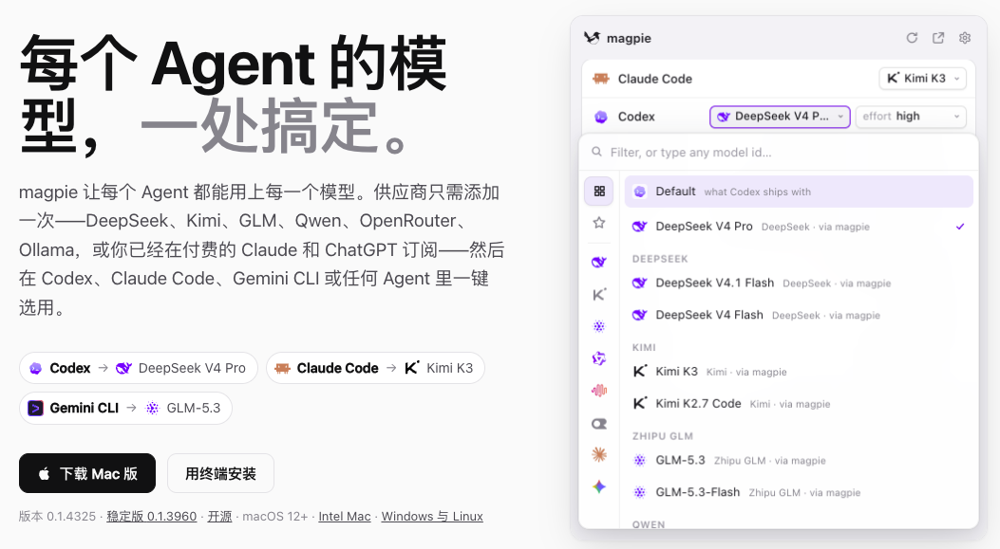
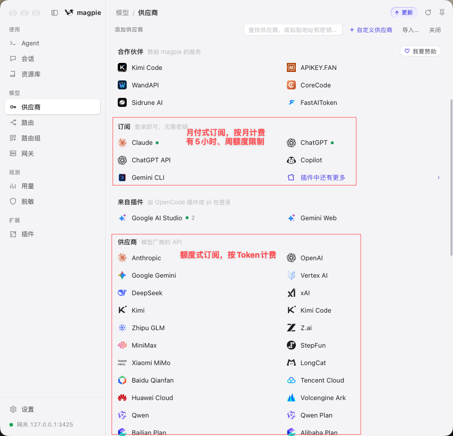
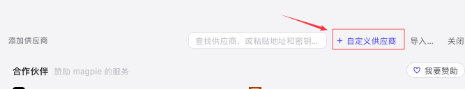
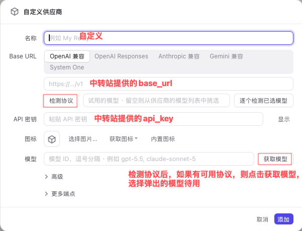
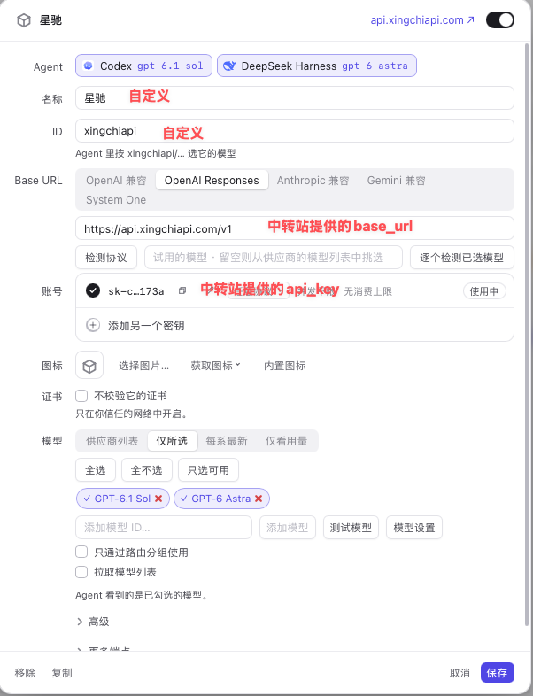
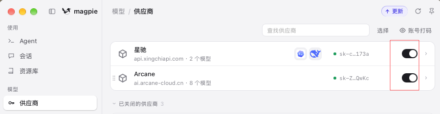
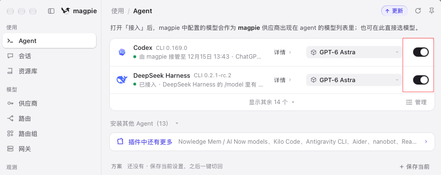
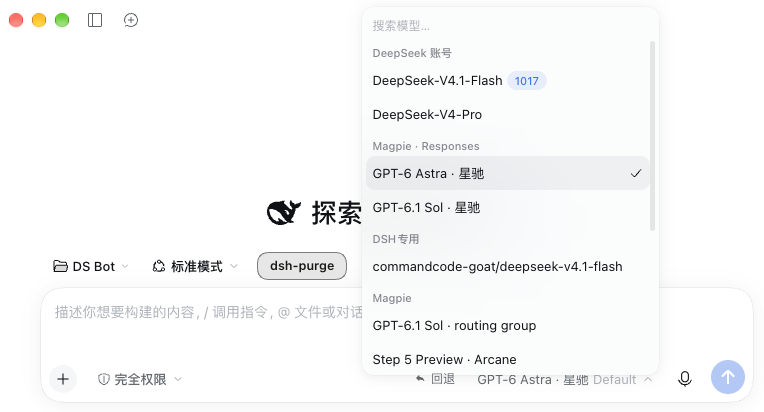
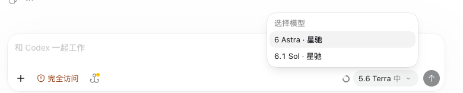
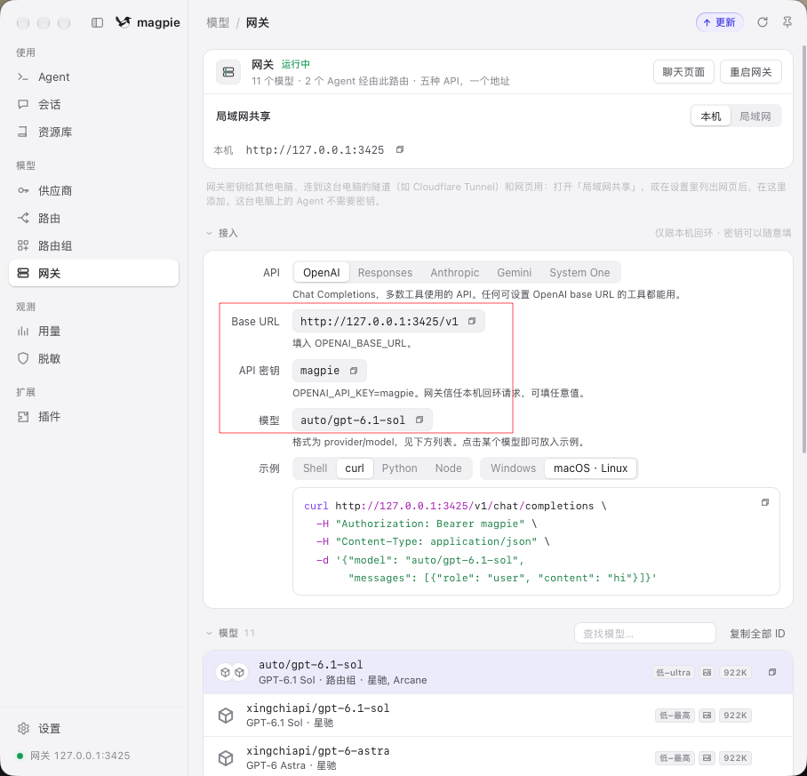

AI 狂潮下，各家大模型服务争相开放，ChatGPT、Claude、Gemini、Grok、DeepSeek、GLM、Kimi、Hy等大模型，订阅服务需要搭配官方的编程客户端，如Codex、Claude Code、Antigravity IDE、DeepSeek Harness、Cursor才能正常使用。有没有办法在DSH里使用ChatGPT的最新模型，或者在cursor里使用ChatGPT的最新模型呢？当然有，**magpie** 就是做这件事的！

### 一、安装Magpie

官网地址：https://usemagpie.ai/

根据自己的电脑系统下载对应的客户端安装即可使用！

## 二、配置Magpie

### 1、添加供应商

如果是从官方订阅的服务，根据自己的付费方式来选择对应的入口添加账号！

* 订阅制：需要登录账号
* 供应商：从官网获取API_KEY使用

如果是从中转站处订阅的服务，则选择“自定义供应商”

### 2、启用已添加的服务

### 3、配置Agent

这一步是为了让不同的编程客户端接入上面添加的供应商模型服务，选择你需要使用的Agent编程客户端启用！

实际效果：

在DeepSeek Harness中

在Codex中

## 三、额外功能

正常情况下，官方AI服务以及大部分中转站提供的服务，都可以通过 Magpie 的网关代理功能来反向代理他们的大模型服务，用于脚本、SDK、其他第三方聊天客户端中！

当然有的服务商会有限制，不能用与脚本、SDK等场景！
